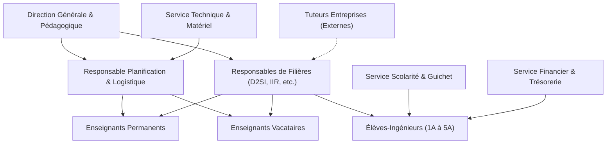
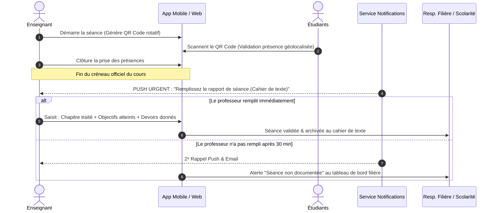
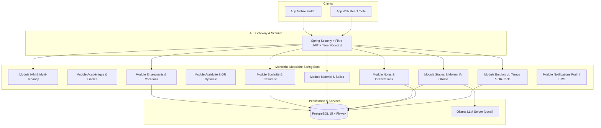
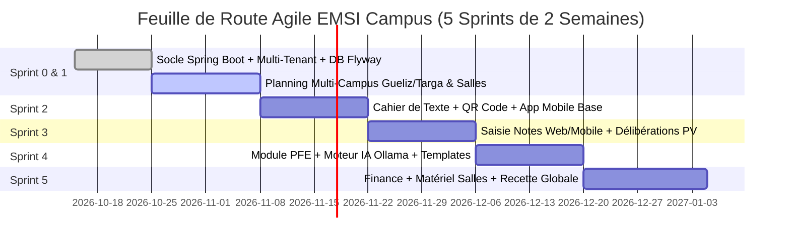

# CAHIER DES CHARGES FONCTIONNEL ET TECHNIQUE (CdCF)
## Système d'Information & ERP Académique Multi-Campus : EMSI Campus (Univora)

---


* **Établissement Client :** École Marocaine des Sciences de l'Ingénieur (EMSI) — Membre d'Honoris United Universities
* **Sites Cibles Pilotes :** EMSI Marrakech (Campus Gueliz & Campus Targa), avec extensibilité Casablanca et Rabat
* **Porteurs du Projet :** Équipe d'Ingénieurs 5ᵉ Année D2SI (Data, Systèmes d'Information & Intelligence Artificielle)
* **Version du Document :** Version 1.0 — Validée pour Conception et Réalisation
* **Date :** Octobre 2026
* **Statut :** Spécification de Référence (Baseline Fonctionnelle & Technique)

---

## Sommaire Général

1. [Page de Garde & Métadonnées](#1-page-de-garde--métadonnées)
2. [Historique des Versions et Validation](#2-historique-des-versions-et-validation)
3. [Résumé Exécutif](#3-résumé-exécutif)
4. [Contexte, Problématique & Analyse Terrain](#4-contexte-problématique--analyse-terrain)
5. [Objectifs Stratégiques & Indicateurs de Réussite (KPIs)](#5-objectifs-stratégiques--indicateurs-de-réussite-kpis)
6. [Parties Prenantes & Matrice RACI](#6-parties-prenantes--matrice-raci)
7. [Périmètre Fonctionnel (In-Scope / Out-of-Scope)](#7-périmètre-fonctionnel-in-scope--out-of-scope)
8. [Profils Utilisateurs & Matrice des Droits (RBAC)](#8-profils-utilisateurs--matrice-des-droits-rbac)
9. [Processus Métier Cibles & Règles de Gestion](#9-processus-métier-cibles--règles-de-gestion)
10. [Exigences Fonctionnelles Détaillées (REQ-XXX)](#10-exigences-fonctionnelles-détaillées-req-xxx)
11. [Exigences Non-Fonctionnelles (QoS & Sécurité)](#11-exigences-non-fonctionnelles-qos--sécurité)
12. [Architecture Technique & Arbitrage des Technologies](#12-architecture-technique--arbitrage-des-technologies)
13. [Modèle de Données & Dictionnaire Conceptuel](#13-modèle-de-données--dictionnaire-conceptuel)
14. [Interfaces, API REST & Intégrations Externes](#14-interfaces-api-rest--intégrations-externes)
15. [Sécurité, Zéro-Trust & Conformité CNDP / RGPD](#15-sécurité-zéro-trust--conformité-cndp--rgpd)
16. [Ergonomie UX/UI & Expérience Mobile](#16-ergonomie-uxui--expérience-mobile)
17. [Stratégie de Test & Assurance Qualité](#17-stratégie-de-test--assurance-qualité)
18. [Méthodologie Agile, Découpage des Sprints & Organisation de l'Équipe](#18-méthodologie-agile-découpage-des-sprints--organisation-de-léquipe)
19. [Planning Directeur, Jalons & Livrables](#19-planning-directeur-jalons--livrables)
20. [Matrice des Risques & Plans de Mitigation](#20-matrice-des-risques--plans-de-mitigation)
21. [Critères de Recette & Mise en Production](#21-critères-de-recette--mise-en-production)
22. [Glossaire](#22-glossaire)
23. [Matrice de Traçabilité des Exigences](#23-matrice-de-traçabilité-des-exigences)

---

## 1. Page de Garde & Métadonnées

* **Titre du Projet :** Plateforme ERP EMSI Campus (Nom de code SaaS : *Univora*)
* **Objet :** Cahier des charges exhaustif formalisant l'ensemble des besoins de gestion académique, logistique, financière, pédagogique et d'intelligence artificielle pour l'École Marocaine des Sciences de l'Ingénieur.
* **Destinataires :** Direction Générale EMSI, Direction Pédagogique, Responsables de Filières (D2SI, IIR, 2IA, Génie Industriel, Génie Civil), Responsables Logistique & Examens, Équipe de Développement.

---

## 2. Historique des Versions et Validation

| Version | Date | Auteur(s) | Modifications apportées | Statut |
| :--- | :--- | :--- | :--- | :--- |
| **v0.1** | 10/10/2026 | Équipe 5A D2SI | Cadrage initial et recueil des besoins bruts. | Brouillon |
| **v0.5** | 14/10/2026 | Équipe 5A D2SI | Ajout de la dimension multi-sites Marrakech (Gueliz & Targa) et IA PFE. | Revue interne |
| **v1.0** | 16/10/2026 | Lead Architect & Scrum Master | Spécification complète conforme à la norme IEEE 830 / ISO 29148 avec exigences REQ-XXX atomiques, MoSCoW, logistique, matériel, scolarité, délibérations et templates officiels. | **Validé pour Réalisation** |

---

## 3. Résumé Exécutif

L'École Marocaine des Sciences de l'Ingénieur (EMSI) regroupe des milliers d'élèves-ingénieurs répartis sur plusieurs campus urbains au Maroc. L'analyse des processus actuels révèle une dispersion d'outils hétérogènes (fichiers Excel pour les notes, formulaires dispersés, coordination téléphonique, portails hérités peu réactifs sur mobile).

**EMSI Campus** est une solution ERP unifiée Web & Mobile combinant :
1. Un **moteur de planification intelligent** prenant en compte les déplacements physiques entre campus d'une même ville (Gueliz ⇄ Targa), les spécificités des salles (labos IA/GPU, réseaux, cours magistraux) et les indisponibilités strictes des vacataires.
2. Un **module de traçabilité pédagogique en temps réel** : rapport de séance / cahier de texte obligatoire avec relance automatique par notification push dès la fin du créneau, émargement dynamique par QR Code et saisie directe des notes bannissant définitivement les fichiers Excel.
3. Un **moteur IA hybride d'affectation des jurys et encadrants de PFE/stages** : extraction des compétences par LLM local (Ollama) et scoring transparent multicritère (spécialité technique, charge, disponibilité).
4. Un **module logistique et gestion du matériel** pour le suivi de l'état des équipements de chaque salle (vidéoprojecteurs, PC défaillants, tables) et tickets de maintenance.
5. Un **suivi rigoureux des frais de scolarité** pour identifier les impayés, relancer les parents et conditionner la délivrance des documents officiels.

---

## 4. Contexte, Problématique & Analyse Terrain

### 4.1. La Réalité des Campus de Marrakech (Gueliz & Targa)
L'EMSI Marrakech opère sur deux pôles distincts :
* **Campus Centre (Gueliz) :** Situé avenue Mansour Eddehbi, pôle historique à forte densité urbaine.
* **Campus Targa :** Campus étendu accueillant les grands amphis et les promotions supérieures d'ingénierie.
* **Problématique constatée :** Les enseignants permanents et surtout les **vacataires** (professionnels en entreprise) dispensent des cours sur les deux sites. Les outils de planning actuels n'intègrent pas le temps de transit (20 à 30 minutes de route), provoquant des retards en chaîne et des salles réservées mais inoccupées.

### 4.2. Les Frictions Pédagogiques Identifiées
* **La saisie des notes sous Excel :** Les enseignants saisissent les notes sur des tableurs locaux avec des formules hétérogènes. Risques majeurs : erreurs de copier-coller, perte d'historique, impossibilité de tracer les modifications et retard important sur la publication des délibérations.
* **L'oubli des rapports de séance (Cahier de texte) :** L'administration peine à savoir quel chapitre a été réellement dispensé. Les enseignants oublient de consigner l'avancement du programme en fin de cours.
* **Le casse-tête des soutenances (2A, 3A, 4A, 5A) :**
  * Manque d'homogénéité : les étudiants utilisent des formats de rapport et diaporama disparates.
  * Affectation des jurys arbitraire : un sujet orienté *Cloud / Microservices Java Spring Boot* se retrouve parfois encadré ou évalué par un enseignant dont la dominante est *Automatisme / Électronique*, par manque de visibilité sur les compétences croisées.
  * Pièces justificatives volantes : attestations de stage et conventions signées égarées ou déposées hors délais.

### 4.3. Les Frictions Administratives, Logistiques et Financières
* **Gestion du matériel :** En cas de vidéoprojecteur défectueux ou de PC hors service en salle TP info, l'incident est transmis verbalement, sans suivi d'intervention.
* **Suivi de la scolarité et trésorerie :** Manque de synchronisation en temps réel entre le paiement effectif des mensualités et l'accès de l'étudiant aux attestations scolaires et bulletins officiels.

---

## 5. Objectifs Stratégiques & Indicateurs de Réussite (KPIs)

| Objectif Métier | Indicateur Clé de Performance (KPI) | Cible Visée |
| :--- | :--- | :--- |
| **Zéro conflit de planning** | Nombre de chevauchements (prof/groupe/salle) et retards inter-campus détectés. | **0 conflit toléré** |
| **Saisie des cahiers de texte** | Taux de rapports de séance renseignés dans les 60 minutes suivant le cours. | **&gt; 95%** (grâce aux push) |
| **Éradication des fichiers Excel** | Pourcentage de notes saisies directement via l'application web/mobile. | **100%** |
| **Pertinence de l'affectation PFE** | Taux d'adéquation compétences sujet / profil encadrant validé par le chef de filière. | **&gt; 90%** d'adéquation |
| **Réduction du temps de délibération** | Délai entre la dernière épreuve et la publication du PV officiel. | Réduit de 10 jours à **24 heures** |
| **Standardisation des soutenances** | Taux de rapports conformes aux templates officiels Word/LaTeX EMSI. | **100%** des dépôts |
| **Recouvrement scolarité** | Visibilité des reliquats de paiement et relances automatisées. | **Temps réel (H+0)** |

---

## 6. Parties Prenantes & Matrice RACI

### 6.1. Répertoire des Parties Prenantes



### 6.2. Matrice RACI Globale

* **R (Responsible) :** Réalise l'action.
* **A (Accountable) :** Approuve et porte la responsabilité finale.
* **C (Consulted) :** Doit être consulté pour avis.
* **I (Informed) :** Doit être tenu informé.

| Domaine Fonctionnel | Direction | Resp. Filière | Planificateur | Enseignant | Étudiant | Scolarité | Finances | Support Tech |
| :--- | :---: | :---: | :---: | :---: | :---: | :---: | :---: | :---: |
| **Création Filières & Modules** | A | R | C | I | I | I | I | I |
| **Emploi du Temps & Salles** | I | C | **R / A** | C | I | I | I | C |
| **Cahier de Texte / Séance** | I | C | I | **R / A** | I | I | I | I |
| **Saisie des Notes & CC** | I | C | I | **R** | I | C | I | I |
| **Délibérations & Rattrapages** | A | **R** | I | C | I | C | I | I |
| **Affectation IA PFE / Jurys** | I | **R / A** | C | C | I | I | I | I |
| **Dépôt Conventions & Stages** | I | C | I | C | **R** | A | I | I |
| **Suivi Matériel des Salles** | I | I | C | C | I | I | I | **R / A** |
| **Frais Scolarité & Blocage** | A | I | I | I | I | C | **R / A** | I |

---

## 7. Périmètre Fonctionnel (In-Scope / Out-of-Scope)

### 7.1. Dans le Périmètre (In-Scope)
* **Pôle Académique :** Gestion multi-campus (Gueliz, Targa...), filières (Informatique, Génie Industriel, Génie Civil...), années (1A à 5A), semestres (S1 à S10), modules et éléments de modules.
* **Pôle Planification :** Emplois du temps automatiques avec solveur de contraintes (OR-Tools / heuristique), gestion des salles banalisées vs labos équipés (GPU, Switchs réseaux), contraintes de temps de transit inter-campus, gestion des alertes d'annulation et créneaux de rattrapage.
* **Pôle Présences & Suivi :** Émargement par QR code dynamique tournant, gestion des justificatifs médicaux sous 48h, **cahier de texte obligatoire avec push de relance aux professeurs en fin de séance**.
* **Pôle Évaluations :** Saisie directe web/mobile des notes de CC, TP, examens et rattrapages, suppression des formulaires Excel, délibérations semestrielles automatisées selon les règles de compensation et d'élimination EMSI.
* **Pôle Stages & Soutenances :** Dépôt des sujets, conventions et attestations de stage pour les 2A (initiation), 3A, 4A (application/PFA) et 5A (PFE) ; mise à disposition des **templates officiels EMSI (Word/LaTeX et PowerPoint)** ; **moteur IA d'affectation des encadrants et jurys selon la spécialité technologique**.
* **Pôle Logistique & Matériel :** Inventaire du matériel des salles (tables, chaises, vidéoprojecteurs, PC de TP fonctionnels/en panne), signalement d'incidents et workflow de réparation.
* **Pôle Finance Scolarité :** Suivi des paiements étudiants (mensualités, acomptes), détection des impayés, listing de relance parents, et blocage conditionnel des documents officiels.
* **Pôle RH Enseignants :** Fiches enseignants (permanents vs vacataires), déclarations de disponibilités, calcul des heures réelles émargées et génération des états d'honoraires de vacation.

### 7.2. Hors Périmètre pour la Première Release (Out-of-Scope)
* Traitement bancaire direct par passerelle de paiement en ligne CB (prévu en v2 ; la v1 gère l'enregistrement administratif des chèques/virements/traites).
* Gestion des logements étudiants ou de la flotte de transport scolaire (non applicable à l'EMSI).
* Système complet de paye RH pour le personnel administratif (limité au calcul des vacations des enseignants).

---

## 8. Profils Utilisateurs & Matrice des Droits (RBAC)

1. **Super Administrateur SaaS (`ROLE_SUPER_ADMIN`) :** Accès global multi-tenant, gestion des licences et paramétrage système.
2. **Directeur Pédagogique (`ROLE_DIRECTOR`) :** Vision d'ensemble sur tous les campus, approbation des PV de délibération, arbitrage disciplinaire et rapports d'audit.
3. **Responsable de Filière (`ROLE_DEPT_HEAD`) :** Gestion des enseignants de sa filière, affectation des modules, validation finale des emplois du temps de la filière, supervision des PFE et présidence des jurys de délibération.
4. **Responsable Planification & Logistique (`ROLE_SCHEDULER`) :** Gestion des salles, lancement du solveur d'emploi du temps, résolution manuelle des conflits, gestion des examens et convocations des surveillants.
5. **Gestionnaire du Matériel / Support Technique (`ROLE_ASSET_MANAGER`) :** Gestion du parc de machines des salles TP, vidéoprojecteurs, suivi des pannes et validation des réparations.
6. **Enseignant Permanent (`ROLE_PROF_PERMANENT`) :** Consultation de l'EDT, saisie des présences, remplissage du cahier de texte après cours, saisie des notes, encadrement PFE, jury de soutenance.
7. **Enseignant Vacataire (`ROLE_PROF_VACATAIRE`) :** Identique à l'enseignant permanent, avec restriction d'accès aux seuls modules attribués, déclaration de disponibilités horaires et consultation de ses heures émargées pour vacation.
8. **Agent de Scolarité (`ROLE_REGISTRAR`) :** Traitement des inscriptions, validation des justificatifs d'absence, génération des attestations scolaires sécurisées avec QR code.
9. **Agent Financier (`ROLE_FINANCE`) :** Saisie des encaissements de scolarité, marquage des statuts d'impayés, activation/désactivation des verrous financiers.
10. **Élève-Ingénieur (`ROLE_STUDENT`) :** Consultation EDT, suivi des notes et absences, scan de présence, dépôt de sujet de stage/PFE, téléchargement des templates officiels EMSI, demande d'attestations.
11. **Tuteur Entreprise Externe (`ROLE_COMPANY_TUTOR`) :** Accès par lien sécurisé OTP pour signer électroniquement la convention et évaluer le stagiaire.

---

## 9. Processus Métier Cibles & Règles de Gestion

### 9.1. Processus de Fin de Séance : Émargement & Cahier de Texte Obligatoire



### 9.2. Règles de Gestion Pédagogiques & Délibérations (RG-PED)
* **RG-PED-01 (Architecture Modulaire) :** Chaque module comprend 1 ou plusieurs éléments de module. Chaque élément a un coefficient propre.
* **RG-PED-02 (Note Modulaire) :** La note du module est la moyenne pondérée des éléments la composant.
* **RG-PED-03 (Seuil de Validation) :** Un module est validé si la note finale est $\ge 12.00 / 20.00$.
* **RG-PED-04 (Note Éliminatoire) :** Toute note d'élément de module $< 7.00 / 20.00$ est éliminatoire. Le module doit obligatoirement être repassé en session de rattrapage, même si la moyenne du module dépasse 12.00.
* **RG-PED-05 (Session de Rattrapage) :** En rattrapage, la note obtenue remplace la note de l'examen final (le contrôle continu CC reste conservé selon la modalité définie par la filière).
* **RG-PED-06 (Assiduité & Élimination) :** À partir de 3 absences non justifiées dans un même module, l'étudiant reçoit un blâme académique et peut être déclaré défaillant pour la session normale.

### 9.3. Règles de Gestion Logistique & Déplacements (RG-LOG)
* **RG-LOG-01 (Contrainte Inter-Campus Gueliz ⇄ Targa) :** Aucun enseignant ne peut être planifié à Targa immédiatement après un cours à Gueliz sans un intervalle minimal de **45 minutes** (temps de trajet + battement).
* **RG-LOG-02 (Priorité Salles Spécialisées) :** Les cours de TP de programmation avancée, IA et Big Data sont affectés en priorité aux salles TP dotées de GPU et machines adaptées. Les modules réseaux nécessitent impérativement les labos équipés de racks physiques Cisco.
* **RG-LOG-03 (Plafond Journalier) :** Un groupe d'étudiants ne peut pas excéder 8 heures de cours par jour ouvrable.

### 9.4. Règles de Gestion PFE & Soutenances (RG-PFE)
* **RG-PFE-01 (Conformité des Livrables) :** Aucun mémoire de stage/PFE ne peut être déposé s'il ne respecte pas le template officiel EMSI (couverture réglementaire, remerciements, structure académique).
* **RG-PFE-02 (Clôture des Dépôts) :** Pour être autorisé à soutenir, l'étudiant doit avoir uploadé : (1) La convention signée par les 3 parties, (2) L'attestation de stage délivrée par l'entreprise, (3) Le rapport final validé par l'encadrant.
* **RG-PFE-03 (Appariement Thématique) :** Les encadrants et membres de jurys doivent posséder des compétences validées dans la thématique dominante du projet (ex: architecture logicielle, data science, cybersécurité, génie industriel).

### 9.5. Règles de Gestion Financière & Scolarité (RG-FIN)
* **RG-FIN-01 (Échéancier de Scolarité) :** Les frais de scolarité sont payables selon l'échéancier choisi (annuel, semestriel ou mensualités du 1er au 5 de chaque mois).
* **RG-FIN-02 (Verrou Administratif Automatique) :** Tout retard de paiement non régularisé après relance formelle entraîne le blocage automatique de l'émission des attestations officielles (scolarité, relevés de notes) sur le portail étudiant.

---

## 10. Exigences Fonctionnelles Détaillées (REQ-XXX)

Toutes les exigences sont formulées selon la norme professionnelle et priorisées selon la méthode **MoSCoW** (*Must have, Should have, Could have, Won't have for this release*).

```
Structure d'une Exigence :
- Identifiant unique
- Titre & Priorité
- Acteur déclencheur
- Préconditions
- Scénario Nominal (étape par étape)
- Scénarios Alternatifs & Exceptions
- Critères d'Acceptation vérifiables
```

---

### Sous-Système 1 : Gestion des Emplois du Temps & Multi-Campus (EDT)

#### REQ-EDT-01 : Planification Automatisée Multi-Sites (Gueliz & Targa)
* **Priorité :** MUST
* **Acteur :** Responsable Planification & Logistique
* **Préconditions :** Les modules de chaque filière (Informatique, Industriel, Civil), les groupes (1A à 5A), les salles de Gueliz et Targa, et les disponibilités des enseignants sont enregistrés.
* **Scénario Nominal :**
  1. Le planificateur sélectionne le semestre et le campus pilote (Marrakech Gueliz / Targa).
  2. Le système lance le solveur sous contraintes (OR-Tools) en intégrant :
     - Disponibilités des profs vacataires (soir/samedi).
     - Typologie de salle requise (salle cours vs labo info vs amphi).
     - Règle de battement inter-campus (RG-LOG-01 : 45 min entre Gueliz et Targa).
  3. Le système produit une proposition d'emploi du temps sans aucun conflit strict.
  4. Le planificateur visualise l'emploi du temps sous format grille interactive, effectue les ajustements marginaux et publie le planning.
* **Scénario Alternatif (Conflit Insoluble) :**
  * Si aucune solution ne satisfait 100% des contraintes souples, le système affiche la liste explicite des goulots d'étranglement (ex: "Manque de 2 salles TP à Targa le jeudi matin") pour arbitrage humain.
* **Critères d'Acceptation :**
  * Zéro double réservation (même prof, même salle ou même groupe au même moment).
  * Aucun enchaînement immédiat entre une salle à Gueliz et une salle à Targa.

#### REQ-EDT-02 : Notification & Gestion des Rattrapages de Séances
* **Priorité :** MUST
* **Acteur :** Enseignant, Délégué, Planificateur
* **Scénario Nominal :**
  1. Un enseignant signale une absence planifiée ou urgente via l'application mobile.
  2. La séance est marquée "ANNULÉE / À RATTRAPER". Les étudiants du groupe reçoivent instantanément une notification push.
  3. L'enseignant ou le responsable de filière demande un créneau de rattrapage parmi les créneaux et salles libres proposés par le système.
  4. Dès validation, la séance de rattrapage s'ajoute à l'agenda de tous les participants avec alerte de confirmation.
* **Critères d'Acceptation :**
  * L'historique des séances annulées et rattrapées reste consultable pour le calcul des vacations.

---

### Sous-Système 2 : Suivi Pédagogique & Cahier de Texte Temps Réel (RAPPORT)

#### REQ-RAP-01 : Notification Push de Fin de Séance & Saisie Obligatoire
* **Priorité :** MUST
* **Acteur :** Enseignant (Permanent ou Vacataire)
* **Préconditions :** Une séance officielle est en cours dans le planning.
* **Scénario Nominal :**
  1. À l'heure exacte de fin de séance (ou 5 minutes avant), le système envoie une notification push prioritaire sur le smartphone de l'enseignant : *« Votre séance de Java EE vient de se terminer. Remplissez votre rapport de séance. »*
  2. L'enseignant clique sur la notification, ce qui ouvre un écran dédié pré-rempli (Matière, Groupe, Date, Heures).
  3. L'enseignant renseigne obligatoirement :
     - L'intitulé du chapitre et les notions clés abordées.
     - L'état d'avancement par rapport au syllabus (ex: 60%).
     - Les éventuels devoirs ou lectures recommandées pour la séance suivante.
  4. L'enseignant valide. Le cahier de texte est instantanément mis à jour pour les étudiants et le chef de filière.
* **Scénario d'Oubli :**
  * Si le rapport n'est pas rempli 30 minutes après le cours, un 2ᵉ rappel push est envoyé.
  * Si après 24 heures le rapport est toujours manquant, la séance apparaît en rouge dans le tableau de bord du Responsable de Filière avec mention "Séance non clôturée".
* **Critères d'Acceptation :**
  * La saisie du rapport prend moins de 60 secondes sur mobile.
  * Le responsable de filière dispose d'une jauge en temps réel du taux de remplissage par professeur.

---

### Sous-Système 3 : Évaluations, Notes & Fin des Fichiers Excel (NOTE)

#### REQ-NOT-01 : Saisie Directe des Notes & Calcul Modulaire Automatisé
* **Priorité :** MUST
* **Acteur :** Enseignant
* **Préconditions :** L'évaluation (CC1, CC2, TP, Mini-Projet, Examen Final) a été créée dans le plan de cours avec son pourcentage.
* **Scénario Nominal :**
  1. L'enseignant accède au module sur son espace Web ou tablette.
  2. La grille de notation de tous les étudiants du groupe s'affiche sous forme de tableau interactif sécurisé (avec support de la navigation rapide au clavier et sauvegarde automatique toutes les 15 secondes).
  3. L'enseignant saisit les notes (valeurs de 0.00 à 20.00 avec contrôle strict des bornes).
  4. Le système calcule immédiatement :
     - La note de l'élément de module.
     - La moyenne générale du module en tenant compte des coefficients.
     - La détection visuelle des notes éliminatoires ($< 7.00$).
  5. L'enseignant clique sur "Soumettre pour validation de filière".
* **Critères d'Acceptation :**
  * Aucune importation de fichier Excel n'est obligatoire pour finaliser la saisie.
  * L'audit trail enregistre chaque modification de note (auteur, valeur précédente, nouvelle valeur, horodatage, adresse IP).

#### REQ-NOT-02 : Moteur de Délibération & Génération des PV de Jury
* **Priorité :** MUST
* **Acteur :** Responsable de Filière, Directeur Pédagogique
* **Scénario Nominal :**
  1. À la clôture des saisies de notes du semestre, le responsable de filière lance le calcul de délibération.
  2. Le système applique automatiquement :
     - Validation du semestre si moyenne $\ge 12.00$ sans élément $< 7.00$.
     - Détermination de la liste des étudiants en session de rattrapage avec la liste précise des éléments de module à repasser.
  3. Le système génère le Procès-Verbal (PV) officiel avec signatures numériques scellées.
  4. Publication des résultats consultables par les étudiants sur l'application mobile.
* **Critères d'Acceptation :**
  * Respect à 100% du règlement des études EMSI.

---

### Sous-Système 4 : Soutenances, Stages & IA d'Affectation (PFE & JURY)

#### REQ-SOUT-01 : Gestion Centralisée des Stages (2A, 3A, 4A et 5A)
* **Priorité :** MUST
* **Acteur :** Élève-Ingénieur, Responsable des Stages
* **Scénario Nominal :**
  1. L'étudiant dépose sa fiche de stage / sujet (Titre, Entreprise d'accueil, Tuteur industriel, Problématique, Stack technologique).
  2. Le responsable pédagogique valide la conformité académique de la mission.
  3. L'étudiant télécharge la convention générée automatiquement, la fait signer par l'entreprise (ou utilise la signature par code OTP) et la ré-uploade avec l'attestation d'assurance.
  4. Avant la date limite de clôture des soutenances, l'étudiant uploade obligatoirement l'**attestation de fin de stage signée** et son **rapport final**.
* **Critères d'Acceptation :**
  * Blocage automatique de la planification de soutenance si les pièces obligatoires (convention + attestation) sont manquantes.

#### REQ-SOUT-02 : Espace Téléchargement des Templates Officiels EMSI
* **Priorité :** MUST
* **Acteur :** Élève-Ingénieur, Enseignant
* **Scénario Nominal :**
  1. L'étudiant et l'encadrant accèdent à la rubrique "Ressources & Charte PFE".
  2. Le système met à disposition au téléchargement :
     - Le template officiel du Rapport PFE sous format Word (`.docx`) et LaTeX (`.tex`) intégrant le logo EMSI, la page de garde normalisée, les polices officielles et les rubriques obligatoires.
     - Le template officiel de Présentation sous format PowerPoint (`.pptx`).
     - Le guide méthodologique de rédaction et d'éthique anti-plagiat.
* **Critères d'Acceptation :**
  * Les templates sont maintenus et mis à jour par la direction pédagogique pour chaque année universitaire.

#### REQ-SOUT-03 : Moteur IA d'Affectation des Encadrants & Jurys par Spécialité
* **Priorité :** MUST
* **Acteur :** Responsable de Filière, Moteur IA
* **Préconditions :** Les profils des enseignants comportent leurs domaines d'expertise technique (ex: Java/Spring Boot, Mobile Flutter, DevOps, IA/Data, Big Data, Génie Civil, Logistique) et leur quota d'encadrement disponible.
* **Scénario Nominal :**
  1. Dès validation du sujet de stage/PFE, le moteur d'IA local (Ollama) extrait les compétences et mots-clés de la description du projet.
  2. Le système compare ces besoins aux expertises des enseignants de l'école.
  3. L'algorithme de scoring calcule pour chaque enseignant un score de pertinence :
     $$\text{Score} = (0.45 \times \text{Compétences}) + (0.35 \times \text{Disponibilité Quota}) + (0.20 \times \text{Historique Thématique})$$
  4. Le système génère une proposition d'affectation :
     - Pour l'encadrant : profil le plus pointu dans la technologie majeure du projet.
     - Pour le jury de soutenance : un Président de jury et un Examinateur ayant des compétences complémentaires dans le domaine (ex: projet SaaS Java & Cloud $\rightarrow$ jury composé d'experts en Génie Logiciel et Cloud).
  5. Le responsable de filière valide en 1 clic la proposition ou modifie manuellement l'affectation si nécessaire.
* **Critères d'Acceptation :**
  * Explicabilité complète : chaque recommandation affiche la justification textuelle ("Recommandé à 92% car expert Spring Boot & Docker, et quota disponible 3/8").
  * Zéro boîte noire : le responsable garde le contrôle absolu de l'affectation (Human-in-the-loop).

---

### Sous-Système 5 : Logistique des Salles, Matériel & Pannes (MATERIEL)

#### REQ-MAT-01 : Inventaire & Cartographie Matérielle des Salles
* **Priorité :** SHOULD
* **Acteur :** Gestionnaire du Matériel / Support Technique, Planificateur
* **Scénario Nominal :**
  1. Chaque salle de Gueliz et Targa est enregistrée avec sa capacité physique (tables, chaises) et ses équipements fixes :
     - Nombre de postes de travail informatiques installés et opérationnels.
     - Spécifications des machines (RAM, GPU, OS).
     - État du vidéoprojecteur et du système de sonorisation.
  2. Le planificateur ne peut affecter un groupe de 30 étudiants en TP de Deep Learning que dans une salle dont l'inventaire indique au moins 30 PC fonctionnels avec cartes GPU.
* **Critères d'Acceptation :**
  * Visibilité instantanée du taux d'équipement fonctionnel par salle et par campus.

#### REQ-MAT-02 : Signalement & Suivi des Pannes Matérielles (Ticketing)
* **Priorité :** SHOULD
* **Acteur :** Enseignant, Délégué, Support Technique
* **Scénario Nominal :**
  1. Pendant une séance, un professeur ou un délégué constate un dysfonctionnement (ex: vidéoprojecteur éteint en salle 204 Gueliz, ou 4 PC non alimentés).
  2. Il ouvre l'application mobile, sélectionne la salle et clique sur "Signaler un problème matériel".
  3. Il précise la nature de la panne et peut joindre une photo de l'équipement.
  4. Une notification d'intervention est immédiatement adressée à l'équipe technique du campus concerné.
  5. Dès résolution, le technicien clôture le ticket. La salle repasse en statut "100% Opérationnelle".
* **Critères d'Acceptation :**
  * Historique des pannes par salle pour identifier le matériel à remplacer lors des investissements annuels.

---

### Sous-Système 6 : Frais de Scolarité & Trésorerie (PAIEMENT)

#### REQ-PAI-01 : Suivi des Paiements & Échéanciers par Étudiant
* **Priorité :** MUST
* **Acteur :** Agent Financier, Étudiant, Parents
* **Scénario Nominal :**
  1. Le service financier paramètre le montant annuel des droits d'inscription et de scolarité selon la filière et l'année d'étude.
  2. Pour chaque étudiant, un tableau d'amortissement / échéancier personnalisé est créé (mode comptant, 3 tranches ou 10 mensualités).
  3. Dès encaissement (chèque, virement, traite), l'agent financier saisit la transaction avec la référence bancaire.
  4. L'étudiant et ses parents reçoivent un reçu numérique et visualisent en temps réel le solde restant dû.
* **Critères d'Acceptation :**
  * Calcul automatique du montant total réglé, des reliquats et des retards en jours.

#### REQ-PAI-02 : Détection des Impayés, Relances & Verrou Administratif
* **Priorité :** MUST
* **Acteur :** Agent Financier, Système
* **Scénario Nominal :**
  1. Le système analyse chaque nuit l'état des échéances échues non régularisées.
  2. Si un retard dépasse le délai de grâce paramétré (ex: 10 jours après l'échéance), le système :
     - Inscrit le dossier sur la liste des "Impayés à Relancer".
     - Génère un modèle de notification / SMS / email formel destiné aux parents.
     - Active automatiquement le drapeau `financial_hold = TRUE` sur le compte de l'étudiant.
  3. Tant que le verrou est actif :
     - L'étudiant continue d'accéder à ses cours et à son emploi du temps (pas de perturbation pédagogique).
     - En revanche, toute demande d'attestation de scolarité, relevé de notes officiel ou convention de stage est bloquée avec le message : *« Veuillez régulariser votre situation financière auprès du service comptabilité pour télécharger ce document officiel. »*
  4. Dès saisie du règlement par la finance, le verrou `financial_hold` est levé immédiatement.
* **Critères d'Acceptation :**
  * Traçabilité complète des actions de verrouillage et déverrouillage financier.

---

### Sous-Système 7 : Gestion RH des Enseignants & Vacations (RH-PROF)

#### REQ-RH-01 : Gestion Différenciée Permanents vs Vacataires
* **Priorité :** MUST
* **Acteur :** Responsable de Filière, Service RH / Direction
* **Scénario Nominal :**
  1. Chaque enseignant est enregistré avec son statut : **Permanent** (volume statutaire annuel) ou **Vacataire** (contrat d'heures au taux horaire défini).
  2. Pour les vacataires, un module de déclaration des créneaux de disponibilité permet de spécifier les plages horaires libres (ex: indisponible en journée du lundi au vendredi, disponible les vendredis soirs et samedis).
  3. Le moteur de planification verrouille l'attribution des cours sur ces seules plages autorisées.
* **Critères d'Acceptation :**
  * Impossibilité de planifier un vacataire sur un créneau non déclaré disponible, sauf forçage explicite avec accord écrit.

#### REQ-RH-02 : Décompte des Heures Réelles Émargées & Ordre de Paiement
* **Priorité :** MUST
* **Acteur :** Service RH / Comptabilité, Enseignant Vacataire
* **Scénario Nominal :**
  1. Le système cumule mensuellement les heures de cours **réellement effectuées** (validées par l'émargement des étudiants et le rapport de séance du professeur).
  2. À la fin de chaque mois calendaire, le système génère un état récapitulatif :
     $$\text{Montant à payer} = \text{Heures Validées} \times \text{Taux Horaire Net/Brut}$$
  3. Le Responsable de Filière valide l'état de vacation.
  4. Le document d'ordre de paiement est exporté pour le virement bancaire.
* **Critères d'Acceptation :**
  * Zéro heure payée pour les séances annulées et non rattrapées.

---

## 11. Exigences Non-Fonctionnelles (QoS & Sécurité)

### 11.1. Performance & Temps de Réponse (NFR-PERF)
* **NFR-PERF-01 :** Le temps de réponse des API REST courantes (consultation de notes, planning, profil) doit être inférieur à **300 ms** au 95ᵉ percentile sous une charge de 2 500 requêtes concurrentes.
* **NFR-PERF-02 :** L'exécution du solveur d'emploi du temps pour une filière complète (5 promotions, 2 campus) ne doit pas excéder **180 secondes**.
* **NFR-PERF-03 :** L'inférence locale Ollama pour l'analyse d'un sujet PFE ne doit pas bloquer le thread web (traitement asynchrone par worker avec notification de fin en moins de 30 secondes).

### 11.2. Disponibilité & Robustesse (NFR-DISP)
* **NFR-DISP-01 :** Disponibilité de la plateforme cible : **99.5%** en période académique normale, **99.9%** pendant les semaines d'examens et de délibérations.
* **NFR-DISP-02 :** Sauvegarde automatique quotidienne de la base de données PostgreSQL avec rétention de 30 jours et stratégie de restauration testée en moins de 2 heures (RTO < 2h, RPO < 15 min).

### 11.3. Sécurité & Confidentialité des Données (NFR-SEC)
* **NFR-SEC-01 :** Chiffrement de toutes les communications en transit via **TLS 1.3**.
* **NFR-SEC-02 :** Hachage des mots de passe utilisateurs avec l'algorithme robuste **BCrypt** (facteur de coût $\ge 12$) ou **Argon2id**.
* **NFR-SEC-03 :** Protection contre les vulnérabilités OWASP Top 10 (Injections SQL, XSS, CSRF, failles de contrôle d'accès au niveau des objets IDOR).

### 11.4. Portabilité & Évolutivité Mobile (NFR-MOB)
* **NFR-MOB-01 :** L'application mobile développée sous **Flutter** doit être 100% compatible Android (API 26+) et iOS (iOS 15+), avec gestion du mode hors-ligne pour la consultation du dernier emploi du temps synchronisé.

---

## 12. Architecture Technique & Arbitrage des Technologies

### 12.1. Arbitrage des Choix d'Ingénierie

L'équipe a examiné les options technologiques conformément aux contraintes académiques et industrielles :

| Composant | Option Retenue | Justification Technique |
| :--- | :--- | :--- |
| **Backend Core** | **Java 21 + Spring Boot 3** | Robustesse d'entreprise, typage fort, écosystème Spring Security / Spring Data JPA mature, support natif de la virtualisation des threads (Project Loom) pour gérer des milliers de requêtes en parallèle. |
| **Frontend Web** | **React + TypeScript + Vite + Tailwind CSS** | Temps de build ultra-rapide avec Vite, typage statique éliminant les bugs de payload, composants modulaires et design moderne aux normes de l'EMSI. |
| **Mobile** | **Flutter + Dart** | Single codebase pour iOS et Android, rendu graphique natif à 60 fps, intégration fluide de la caméra pour scan QR et géolocalisation. |
| **Base de Données** | **PostgreSQL 15+ & Flyway** | Support natif du JSONB (pour les extractions IA et compétences), conformité ACID absolue, intégrité référentielle et migrations de schémas versionnées avec Flyway. |
| **Moteur IA PFE** | **Ollama Local (Llama3 / Mistral)** | Respect absolu de la confidentialité des sujets d'entreprises (aucune donnée envoyée vers des API tierces type OpenAI), coût d'exploitation nul et indépendance réseau. |
| **Solveur Planning** | **Google OR-Tools (Java API)** | Bibliothèque de référence mondiale pour les problèmes de satisfaction de contraintes (CSP) et d'optimisation linéaire combinatoire. |

### 12.2. Architecture Logique en Monolithe Modulaire



---

## 13. Modèle de Données & Dictionnaire Conceptuel

Le schéma physique complet est matérialisé dans le script Flyway `database/migrations/V1__init_schema.sql`.

### Entités Piliers & Relations :
1. **`tenants` :** Établissements isolés (EMSI Marrakech, EMSI Casablanca, etc.).
2. **`campuses` & `campus_travel_times` :** Sites (Gueliz, Targa) et matrice de déplacement inter-sites.
3. **`rooms` & `room_assets` :** Salles et état du parc matériel (PC, vidéoprojecteurs).
4. **`programs` & `modules` & `module_elements` :** Maquettes de filières (D2SI, IIR, etc.).
5. **`professors` & `professor_availabilities` & `professor_skills` :** Statuts (Permanent/Vacataire), créneaux et expertises.
6. **`course_sessions` & `attendances` :** Séances réelles, émargements et **cahier de texte**.
7. **`evaluations` & `grades` & `deliberation_results` :** Notes et PV de jury.
8. **`pfe_topics` & `pfe_extracted_features` & `pfe_recommendations` :** Stages et recommandations IA.
9. **`teaching_hours_logs` :** Décompte mensuel pour paiement des vacations.
10. **`student_tuition_accounts` & `tuition_payments` :** Suivi des frais de scolarité et impayés.

---

## 14. Interfaces, API REST & Intégrations Externes

Toutes les interfaces applicatives sont documentées selon le standard **OpenAPI 3.0 / Swagger** :

* **Auth & Profil :** `POST /api/v1/auth/login`, `GET /api/v1/users/me`
* **Planning :** `GET /api/v1/schedule/group/{groupId}`, `POST /api/v1/schedule/generate`
* **Séances & Cahier de Texte :** 
  * `POST /api/v1/sessions/{id}/start-qr` (génération token tournant)
  * `POST /api/v1/sessions/{id}/report` (soumission cahier de texte obligatoire)
* **Évaluations & Notes :** `POST /api/v1/evaluations/{id}/grades`, `POST /api/v1/deliberations/run`
* **PFE & IA :** `POST /api/v1/pfe/topics/{id}/analyze-ai`, `GET /api/v1/pfe/topics/{id}/recommendations`
* **Scolarité & Finance :** `GET /api/v1/finance/students/{id}/statement`, `POST /api/v1/finance/payments`
* **Matériel des Salles :** `POST /api/v1/assets/incidents` (signalement panne vidéoprojecteur / PC)

---

## 15. Sécurité, Zéro-Trust & Conformité CNDP / RGPD

1. **Isolation Multi-Tenant Robuste :** Chaque requête HTTP est filtrée par le backend qui résout le `tenant_id` depuis le token JWT authentifié. Les clauses SQL sont protégées via les filtres Hibernate 6 (`@TenantId`) pour empêcher rigoureusement toute fuite de données entre campus ou filières.
2. **Protection de la Vie Privée (Loi 09-08 CNDP Maroc) :**
   * Consentement explicite sur l'utilisation des données personnelles et d'assiduité.
   * Droit d'accès et de rectification pour chaque élève et enseignant.
   * Chiffrement des numéros d'anonymat lors des sessions d'examens finaux.
3. **Audit Trail Immuable :** Toute modification de note après délibération, levée de verrou financier ou annulation de cours est consignée dans une table `audit_logs` non modifiable par les utilisateurs ordinaires.

---

## 16. Ergonomie UX/UI & Expérience Mobile

* **Identité Visuelle :** Utilisation stricte de la charte graphique officielle de l'EMSI (Vert Émeraude `#059669` / `#064e3b`, Blanc, Gris ardoise `#0f172a`).
* **Design System :** Composants Tailwind accessibles conformes à la norme WCAG 2.1 AA (contraste de couleur $\ge 4.5:1$).
* **Ergonomie Mobile Flutter :**
  * Navigation intuitive par onglets en bas d'écran (EDT, Notes, Scanner QR, Profil).
  * Widget d'accès rapide à l'emploi du temps du jour sur l'écran d'accueil du smartphone.
  * Notifications push exploitant Firebase Cloud Messaging (FCM).

---

## 17. Stratégie de Test & Assurance Qualité

* **Tests Unitaires & d'Intégration Backend :** JUnit 5, Mockito et Spring Boot Test (Testcontainers pour tester les vraies requêtes PostgreSQL). Couverture de code cible : **$\ge 75\%$** sur les services métiers.
* **Tests Frontend Web :** Vitest et React Testing Library pour les formulaires de notes et les grilles de planning.
* **Tests End-to-End (E2E) :** Playwright pour vérifier les parcours critiques (connexion $\rightarrow$ saisie de note $\rightarrow$ génération de PV).
* **Tests Mobile :** Flutter Widget Tests et tests d'intégration sur simulateurs Android/iOS.

---

## 18. Méthodologie Agile, Découpage des Sprints & Organisation de l'Équipe

Le projet est exécuté selon le framework **Scrum** sur 5 Sprints de 2 semaines, menés par l'équipe de 6 étudiants ingénieurs D2SI répartis en 3 binômes opérationnels :



---

## 19. Planning Directeur, Jalons & Livrables

| Jalon | Date Cible | Livrables Attendus |
| :--- | :--- | :--- |
| **M0 : Cadrage & Architecture** | 16/10/2026 | Cahier des charges validé, Schéma DB Flyway V1, Dépôt Git configuré avec CI/CD. |
| **M1 : Core Planning & Salles** | 08/11/2026 | Moteur OR-Tools opérationnel, résolution des contraintes Gueliz/Targa. |
| **M2 : Mobile & Présences** | 22/11/2026 | App Flutter déployée, scan QR dynamique, notification de fin de cours & cahier de texte. |
| **M3 : Notes & Délibérations** | 06/12/2026 | Module complet de notation (adieu Excel), calcul de moyennes et PV officiels. |
| **M4 : PFE & IA Ollama** | 20/12/2026 | Extraction sémantique des compétences et matching automatique des jurys et encadrants. |
| **M5 : Release Finale & Recette** | 05/01/2027 | Intégration Trésorerie, gestion matériel des salles, tests E2E et préparation soutenance. |

---

## 20. Matrice des Risques & Plans de Mitigation

| Risque Identifié | Impact | Probabilité | Plan de Mitigation Obligatoire |
| :--- | :---: | :---: | :--- |
| **Solveur OR-Tools trop lent ou insoluble** | Élevé | Moyenne | Découper les contraintes en dures (hard) et souples (soft). Fixer un timeout de résolution à 60s avec retour de la meilleure solution approchée. |
| **Latence ou indisponibilité du serveur Ollama** | Moyen | Moyenne | Traitement asynchrone par file d'attente (Spring Async / RabbitMQ) avec fallback déterministe par recherche de mots-clés. |
| **Oubli persistant des professeurs de remplir le cahier de texte** | Élevé | Élevée | Notifications push répétées à H+0, H+30 min et escalade dans le tableau de bord du chef de filière. |
| **Fraude au scan QR code entre étudiants absents** | Élevé | Élevée | QR Code rotatif dynamique (TOTP 10 secondes) avec contrôle de géolocalisation ou restriction sur l'IP du campus. |
| **Non-respect des délais de paiement scolarité** | Élevé | Élevée | Verrouillage automatique de la délivrance des attestations et relevés de notes officiels sur l'application. |

---

## 21. Critères de Recette & Mise en Production

La recette finale ne sera prononcée que si :
1. 100% des exigences identifiées comme **MUST** ont été testées avec succès sur l'environnement de staging.
2. Zéro anomalie bloquante ou critique en production.
3. Le temps de génération d'un emploi du temps complet ne dépasse pas 3 minutes.
4. L'application mobile fonctionne sans crash sur les terminaux de test Android et iOS.
5. La conformité des PV de délibération avec les règles de calcul officielles de l'EMSI est validée formellement par un responsable pédagogique.

---

## 22. Glossaire

* **D2SI :** Données, Systèmes d'Information et Intelligence Artificielle (filière d'ingénierie EMSI).
* **IIR :** Informatique et Réseaux.
* **PFE :** Projet de Fin d'Études (réalisé en 5ᵉ année).
* **PFA :** Projet de Fin d'Année (réalisé en 4ᵉ année).
* **OR-Tools :** Suite logicielle d'optimisation combinatoire de Google.
* **Ollama :** Moteur d'exécution local pour modèles de langage (LLM).
* **DoD (Definition of Done) :** Critères d'acceptation stricts validant l'achèvement d'une tâche.
* **TOTP :** *Time-based One-Time Password*, protocole de code à usage unique basé sur le temps.

---

## 23. Matrice de Traçabilité des Exigences

| Code Exigence | Titre Exigence | Priorité | Module Backend | Écran Frontend / Mobile | Test Associé |
| :--- | :--- | :---: | :--- | :--- | :--- |
| **REQ-EDT-01** | Planning Multi-Sites Gueliz/Targa | MUST | `ScheduleOptimizerService` | `ScheduleCalendarView.tsx` | `ScheduleConflictTest.java` |
| **REQ-EDT-02** | Annulation & Rattrapage | MUST | `SessionRescheduleService` | `RescheduleModal.tsx` / Mobile | `ReschedulePushTest.java` |
| **REQ-RAP-01** | Push & Rapport Séance Cahier Texte | MUST | `CourseSessionReportService` | `SessionReportScreen.dart` | `SessionReportPushTest.java`|
| **REQ-NOT-01** | Saisie Notes sans Excel | MUST | `GradeManagementService` | `GradesGridMatrix.tsx` | `GradeCalculationTest.java` |
| **REQ-NOT-02** | Délibérations & PV Jury | MUST | `DeliberationEngineService` | `DeliberationDashboard.tsx` | `DeliberationRulesTest.java`|
| **REQ-SOUT-01**| Dépôt Stages & Conventions | MUST | `InternshipAgreementService` | `InternshipVaultView.tsx` | `AgreementWorkflowTest.java`|
| **REQ-SOUT-02**| Templates Officiels Word/LaTeX/PPT | MUST | `DocumentTemplateService` | `TemplatesDownloadView.tsx` | `TemplateIntegrityTest.java`|
| **REQ-SOUT-03**| Moteur IA Matching PFE/Jurys | MUST | `OllamaMatchingService` | `AiRecommendationsView.tsx`| `AiScoringAccuracyTest.java`|
| **REQ-MAT-01** | Inventaire Matériel Salles TP | SHOULD | `RoomAssetManagementService` | `RoomInventoryView.tsx` | `RoomCapacityTest.java` |
| **REQ-MAT-02** | Ticketing Pannes Salles | SHOULD | `IncidentTicketService` | `IncidentReportScreen.dart` | `TicketWorkflowTest.java` |
| **REQ-PAI-01** | Suivi Échéancier Scolarité | MUST | `TuitionBillingService` | `StudentFinanceView.tsx` | `BillingCalculationTest.java`|
| **REQ-PAI-02** | Verrou Financier sur Documents | MUST | `FinancialHoldAspect` | `DocumentRequestView.tsx` | `FinancialHoldSecurityTest.java`|
| **REQ-RH-01**  | Profils Vacataires & Dispos | MUST | `ProfessorContractService` | `TeacherAvailabilityView.tsx`| `AvailabilityConstraintTest.java`|
| **REQ-RH-02**  | Décompte Heures Vacation | MUST | `VacationPayrollService` | `PayrollSummaryView.tsx` | `PayrollCalculationTest.java`|

---
*Fin du document officiel du Cahier des Charges — Équipe EMSI Campus D2SI.*
