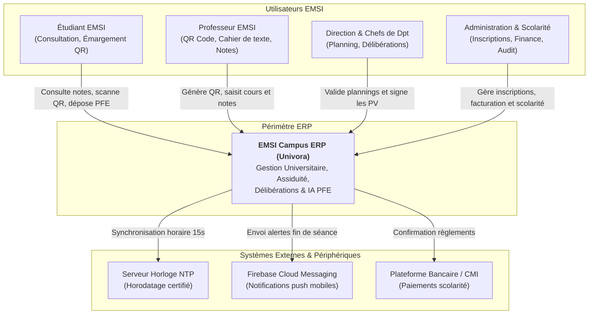

# DOCUMENT D'ARCHITECTURE SYSTÈME (PHASE D)

**Projet :** EMSI Campus ERP (Univora) — Système Intégré de Gestion Universitaire & Campus Intelligent  
**Établissement :** École Marocaine des Sciences de l'Ingénieur (EMSI Marrakech — Campus Guéliz & Targa)  
**Encadrement :** Pr. ZGANDRI (Encadrante Académique), Pr. AIT OUNEJJAR Lahoussaine (Président de Jury)  
**Référentiel Méthodologique :** ISO/IEC/IEEE 42010:2022 & Modèle C4 (Context, Containers, Components)  
**Statut du Document :** Référence Architecturale Normative  

---

## 1. Vue d'Ensemble & Objectifs Architecturaux

Le système **EMSI Campus ERP** est conçu pour unifier l'ensemble des processus critiques académiques, logistiques et administratifs au sein d'une plateforme résiliente, modulaire et hautement sécurisée.

### Objectifs Clés du Système
1. **Zéro Erreur dans la Planification & Logistique :** Respect mathématique absolu des temps de transit inter-campus (45 min entre Guéliz et Targa) et de la non-collision des ressources.
2. **Élimination de la Fraude à l'Assiduité :** Émargement mobile instantané par QR code dynamique tournant toutes les 15 secondes avec validation cryptographique et anti-rejeu.
3. **Fiabilisation des Délibérations ("Zéro Excel") :** Éradication des erreurs humaines de calcul de moyennes et scellement infalsifiable des procès-verbaux officiels.
4. **Souveraineté des Données & IA Locale :** Aucune donnée académique ou mémoire d'étudiant n'est transmis à un tiers cloud (hébergement local du LLM Llama 3.2 via Ollama).
5. **Conformité Réglementaire CNDP (Loi 09-08) :** Immuabilité et auditabilité de chaque manipulation de note ou de dossier personnel.

---

## 2. Modèle C4 — Vues Architecturales

```
┌─────────────────────────────────────────────────────────────┐
│  NIVEAU 1 : C4 CONTEXTE SYSTÈME                             │
│  Acteurs Humains (Étudiants, Profs, Direction) & Systèmes   │
└──────────────┬──────────────────────────────────────────────┘
               │
               ▼
┌─────────────────────────────────────────────────────────────┐
│  NIVEAU 2 : C4 CONTENEURS                                   │
│  Next.js 15, Flutter, Spring Boot 3.3, Redis, Postgres,     │
│  MinIO, Worker OR-Tools, Service Ollama                     │
└──────────────┬──────────────────────────────────────────────┘
               │
               ▼
┌─────────────────────────────────────────────────────────────┐
│  NIVEAU 3 : C4 COMPOSANTS                                   │
│  Clean Architecture au sein de Spring Boot Core             │
│  (Auth, Planning, Attendance, Delib, PFE, Finance, Audit)   │
└─────────────────────────────────────────────────────────────┘
```

### 2.1. Niveau 1 : Diagramme de Contexte Système (System Context)



---

### 2.2. Niveau 2 : Diagramme de Conteneurs (Containers)

| Conteneur | Rôle & Responsabilité | Technologies Clés | Protocole d'Échange |
| :--- | :--- | :--- | :--- |
| **Portail Web** | Interface réactive pour la direction, administration et professeurs | React 19, Next.js 15, Tailwind, Shadcn/UI | HTTPS / REST / WSS |
| **Application Mobile** | Application nomade pour étudiants et professeurs (émargement, emploi du temps) | Flutter 3.24, Riverpod, Isar DB | HTTPS / REST / WSS |
| **Passerelle d'Accès** | Terminaison SSL, limitation de débit, routage et reverse proxy | Nginx 1.25 Alpine | HTTPS / TLS 1.3 |
| **Core API Backend** | Cœur applicatif, logique métier, délibérations, gestion des droits | Java 21 LTS, Spring Boot 3.3, Spring Security | JDBC, gRPC, HTTP |
| **Solveur Planning** | Résolution des contraintes linéaires combinatoires (transit 45 min) | Python 3.11, Google OR-Tools (CP-SAT), FastAPI | gRPC / HTTP Interne |
| **Service IA Locale** | Génération d'embeddings vectoriels et matching sémantique des mémoires PFE | Ollama Daemon, Llama 3.2 (3B), Nomic-Embed | HTTP REST Interne |
| **Base Relationnelle** | Stockage transactionnel ACID, intégrité référentielle, vecteurs | PostgreSQL 16 avec extension pgvector | Protocole PostgreSQL (Port 5432) |
| **Cache & Éphémère** | Sessions, jetons QR tournants 15s, compteurs de présence temps réel | Redis 7.2 Cluster | Protocole RESP (Port 6379) |
| **Stockage Fichiers** | Stockage sécurisé des mémoires PFE, scans de justificatifs, PV signés | MinIO Object Storage (Compatible AWS S3) | S3 API (Port 9000) |

---

### 2.3. Niveau 3 : Diagramme de Composants du Cœur Applicatif (Components)

Le composant principal `Core API Backend` est structuré selon les préceptes de la **Clean Architecture** (Architecture Hexagonale) :

```
[Contrôleurs REST & WebSocket] (Ports Primaires d'Entrée)
           │
           ▼
[Cas d'Utilisation Applicatifs (Use Cases)]
           │
           ▼
[Modèle de Domaine & Règles Invariables (Clean Domain)]
           ▲
           │
[Adaptateurs d'Infrastructure & Repositories] (Ports Secondaires de Sortie)
 ├── Adaptateur PostgreSQL (Spring Data JPA)
 ├── Adaptateur Cache Redis (Redisson)
 ├── Adaptateur Solveur OR-Tools (Client gRPC)
 └── Adaptateur IA Ollama (Client HTTP)
```

---

## 3. Tactiques de Qualité Logicielle & Résilience

### 3.1. Disponibilité et Tolérance aux Pannes
- **Pattern Circuit Breaker (Resilience4j) :**
  En cas de saturation du conteneur Ollama (calcul d'embeddings lourd) ou du worker OR-Tools, le disjoncteur bascule en mode ouvert : les requêtes d'affectation sont placées dans une file asynchrone persistée sans impacter les fonctionnalités critiques (émargement, consultation de notes).
- **Architecture de Cache Read-Through :**
  Les plannings de cours sont mis en cache chaud dans Redis avec une politique d'invalidation sélective basée sur les événements de modification de créneau (`EvictByGroup` ou `EvictByTeacher`).

### 3.2. Sécurité en Profondeur (Defense in Depth)
- **Authentification Stateless à double niveau :** Access Token JWT (validité 15 min, signé RSA-SHA256) + Refresh Token rotatif (validité 7 jours en cookie sécurisé).
- **Protection Anti-Fraude d'Émargement :**
  - Validation du jeton tournant HMAC (15 secondes).
  - Validation de la géolocalisation réseau du campus (sous-réseau Wi-Fi campus EMSI ou coordonnées GPS avec tolérance 100m).
  - Détection de collision d'empreinte matérielle (`device_id`) interdisant l'émargement multiple pour des tiers depuis le même smartphone.

---

## 4. Stratégie Multi-Tenant et Évolutivité Multi-Campus

L'architecture supporte nativement l'extension d'EMSI Marrakech (Guéliz et Targa) vers l'ensemble des campus du Royaume (Casablanca, Rabat) puis vers une offre SaaS dédiée à l'enseignement supérieur privé :

- **Clé de Partition Logique :** Chaque table métier intègre une colonne indexée `tenant_id` (identifiant de l'institution) et `campus_id` (site physique).
- **Intercepteur Transparent Hibernate :**
  ```java
  @FilterDef(name = "tenantFilter", parameters = @ParamDef(name = "tenantId", type = String.class))
  @Filter(name = "tenantFilter", condition = "tenant_id = :tenantId")
  ```
- **Gestion des Temps de Transit Dynamique :** La table `campus_transit_rules` modélise les matrices de distance inter-sites :
  - `Gueliz <-> Targa` : 45 minutes obligatoires.
  - Deux campus d'une même ville distante : calcul dynamique via matrice de trafic.
