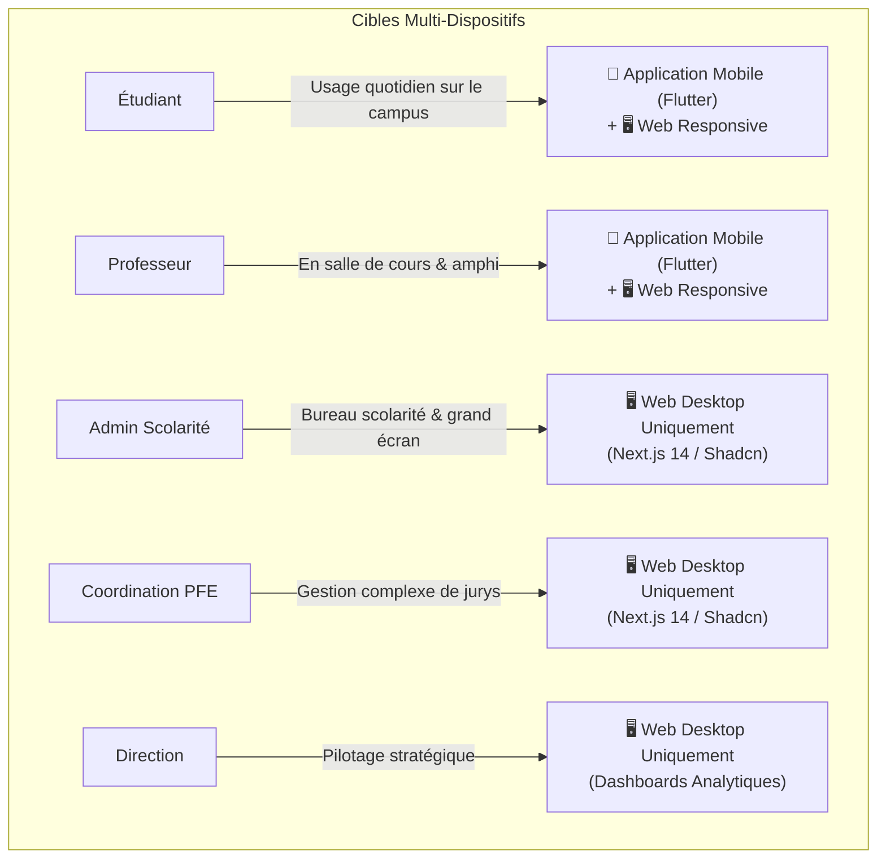

# 01. Analyse Produit & Exigences UI/UX — UNiVora ERP (EMSI Campus)

**Projet** : UNiVora — Système d'Information & ERP Universitaire Multi-Campus  
**Établissement** : École Marocaine des Sciences de l'Ingénieur (EMSI Marrakech : Guéliz & Targa)  
**Encadrante Académique** : **Pr. ZGANDRI**  
**Membre du Jury** : **Pr. AIT OUNEJJAR Lahoussaine**  
**Date d'Analyse** : 2024–2025  

---

## 1. Contexte Métier & Périmètre Applicatif

L'EMSI exploite deux campus majeurs à Marrakech : **Campus Guéliz** et **Campus Targa**.
La gestion académique, la présence par émargement digital, la planification des emplois du temps et les délibérations de fin de semestre étaient historiquement fragmentées. 

UNiVora ERP unifie l'ensemble de ces flux au sein d'une plateforme sécurisée et accessible selon les rôles suivants :
1. **Étudiant** : Consultation mobile & web du planning, émargement QR code dynamique (15s), consultation des notes et relevés, soumission et suivi PFE, suivi financier.
2. **Professeur** : Émargement mobile & web, lancement de séance avec projection de QR tournant, saisie des notes (CC, TP, Examen), suivi d'encadrement PFE.
3. **Administration de la Scolarité** : Génération automatisée des plannings via solveur de contraintes OR-Tools, moteur de délibération "Zéro Excel", édition des PVs et attestations académiques.
4. **Coordination PFE** : Matching sémantique par IA locale (Ollama Llama 3.2), vérification anti-plagiat, planification des soutenances et désignation des jurys.
5. **Direction Générale / Campus** : Tableaux de bord de gouvernance multi-campus, KPIs de réussite, ratios d'absentéisme et suivi de la masse horaire.

---

## 2. Invariants & Règles Métier Critiques d'Interface

L'interface doit intégrer visuellement et fonctionnellement les 7 règles d'or du système :

| Règle | Libellé | Impact Ergonomique & IHM |
| :--- | :--- | :--- |
| **`RULE-GEO-01`** | **Buffer Transit 45 min** | Alerte visuelle de conflit géographique si un professeur ou un groupe d'élèves enchaîne deux cours sur Guéliz et Targa sans 45 min d'intervalle. |
| **`RULE-ATT-02`** | **QR Code Dynamique 15s** | Affichage d'un QR code haute densité avec anneau de compte à rebours dynamique circulaire (15 secondes) et régénération automatique sans scintillement. |
| **`RULE-NOT-03`** | **Notification Clôture Séance** | Déclenchement automatique d'un rappel push/toast pour le professeur à l'heure exacte de fin de séance pour valider le cahier de texte. |
| **`RULE-DELIB-04`** | **Note Éliminatoire < 7.00/20** | Coloration d'alerte rouge cramoisi (`#DC2626`) immédiate avec icône d'avertissement et mention explicite "Module non validé - Note éliminatoire". |
| **`RULE-AI-05`** | **Matching IA PFE > 70%** | Badge de similarité vectorielle avec jauge de score chromatique (Vert si $\ge 80\%$, Ambre si $70-79\%$, Grisé si $< 70\%$). |
| **`RULE-FIN-06`** | **Blocage Attestations Financier** | Verrouillage visuel (icône cadenas rouge) du bouton de téléchargement d'attestation si impayé $> 10$ jours, avec modale explicative de régularisation. |
| **`RULE-SEC-07`** | **Audit Trail Immuable CNDP** | Traçabilité des actions sensibles avec badge de conformité Loi 09-08 sur les interfaces d'administration. |

---

## 3. Matrice des Cibles Périphériques & Contraintes Matérielles

Conformément aux besoins opérationnels exprimés par les utilisateurs de l'EMSI :

- **Espaces Étudiant & Professeur** : Doivent offrir une ergonomie **Mobile First native** (formats smartphone 393px, navigation basse à onglets, boutons adaptés au pouce) ainsi qu'une vue Web de bureau fluide.
- **Espaces Administration, PFE & Direction** : Exigent une surface d'affichage **Desktop Web** optimisée pour la haute densité de données (tableaux de 12 colonnes, volets de détails dépliables, filtres multi-critères).
