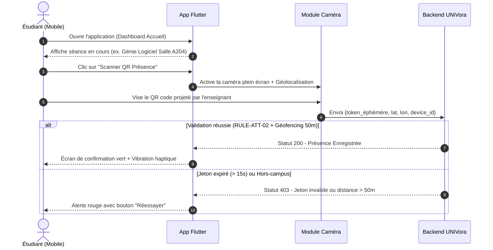

# 02. Parcours Utilisateurs (User Journeys) — UNiVora ERP

**Encadrante** : **Pr. ZGANDRI** | **Jury** : **Pr. AIT OUNEJJAR Lahoussaine**  
Ce document détaille les parcours utilisateurs nominaux, alternatifs et d'exception pour chaque rôle applicatif.

---

## 1. Parcours Rôle 1 : Étudiant (Mobile & Web)

### Objectif Principal
Accéder rapidement à son emploi du temps quotidien, émarger sans friction par scan QR dans les 15 secondes, suivre ses notes avec transparence et candidater aux sujets de PFE.

### Étapes Clés du Parcours Étudiant
1. **Écran d'Accueil** (`SCR-STU-01`) : Badge campus (Guéliz/Targa), carte du prochain cours avec compte à rebours, widget de présence globale (ex. 94.2%).
2. **Emploi du Temps** (`SCR-STU-02`) : Vue jour/semaine, indication des salles, filière, professeur, alerte de changement de salle.
3. **Scanner QR Présence** (`SCR-STU-03`) : Viseur dynamique avec animation laser, détection automatique, indicateur GPS vert.
4. **Notes & Délibérations** (`SCR-STU-04`) : Liste des modules, notes de CC, TP, Examen, détection de note éliminatoire (`RULE-DELIB-04`), téléchargement du relevé officiel.
5. **Portail PFE** (`SCR-STU-05`) : Catalogue des sujets validés avec tag de filière, candidature en 1 clic avec upload de CV, statut d'acceptation.
6. **Espace Financier** (`SCR-STU-06`) : État des règlements, historique des factures, téléchargement des attestations scolarité ou notification de blocage (`RULE-FIN-06`).

---

## 2. Parcours Rôle 2 : Professeur (Mobile & Web)

### Objectif Principal
Lancer la séance de cours en salle, projeter le QR code dynamique tournant, contrôler en direct les étudiants présents, saisir les notes de contrôles et valider les jalons PFE.

### Étapes Clés du Parcours Professeur
1. **Dashboard Enseignant** (`SCR-PRF-01`) : Liste des cours du jour, notifications administratives, bouton d'action rapide "Démarrer Séance".
2. **Gestion de Séance & Projection QR** (`SCR-PRF-02`) :
   - Mode plein écran pour projection vidéo.
   - Jeton HMAC régénéré toutes les 15 secondes (`RULE-ATT-02`).
   - Compteur circulaire visuel (15s -> 0s).
   - Liste en direct des émargements confirmés (ex. 28/32 étudiants).
   - Possibilité de régularisation manuelle justifiée.
3. **Cahier de Texte & Clôture** (`SCR-PRF-03`) : Remplissage des objectifs pédagogiques traités avant clôture définitive (`RULE-NOT-03`).
4. **Saisie des Notes** (`SCR-PRF-04`) : Grille de saisie CC / TP / Examen avec contrôle de validité immédiat (0 à 20) et alerte éliminatoire.
5. **Encadrement PFE** (`SCR-PRF-05`) : Validation des rapports mensuels M1/M2/M3 et notation d'encadrement.

---

## 3. Parcours Rôle 3 : Administration Scolarité (Web Desktop)

### Objectif Principal
Superviser les inscriptions, générer les plannings sans conflit inter-campus, piloter le moteur de délibération "Zéro Excel" et éditer les PVs officiels signés.

### Étapes Clés du Parcours Scolarité
1. **Tableau de Bord Général** (`SCR-ADM-01`) : Effectifs actifs par campus (Guéliz : 1 450, Targa : 1 280), alertes de conflits d'emploi du temps, sessions de délibération ouvertes.
2. **Génération de Plannings OR-Tools** (`SCR-ADM-02`) : Lancement du solveur de contraintes CP-SAT avec respect impératif du buffer de 45 min (`RULE-GEO-01`).
3. **Moteur de Délibération "Zéro Excel"** (`SCR-ADM-03`) :
   - Tableau complet des étudiants d'une filière avec moyennes calculées à la volée.
   - Calcul automatique : $MG = \frac{\sum (NM_i \times Coeff_i)}{\sum Coeff_i}$.
   - Détection instantanée des notes éliminatoires $< 7.00/20$ (`RULE-DELIB-04`) colorées en rouge.
   - Attributions des mentions (Admis, Assez Bien, Bien, Très Bien, Rattrapage, Redoublement).
   - Bouton de génération du Procès-Verbal officiel signé.
4. **Gestion Financière & Déblocage** (`SCR-ADM-04`) : Supervision des impayés et régularisation des blocages (`RULE-FIN-06`).

---

## 4. Parcours Rôle 4 : Coordination PFE (Web Desktop)

### Objectif Principal
Valider les sujets de thèse, exécuter l'appariement sémantique IA (Ollama Llama 3.2), constituer les jurys d'évaluation et planifier les soutenances.

### Étapes Clés du Parcours PFE
1. **Validation des Sujets** (`SCR-PFE-01`) : Revue des propositions soumises par les enseignants et entreprises partenaires, détection anti-doublon.
2. **Appariement Intelligent IA** (`SCR-PFE-02`) : Déclenchement de l'algorithme de similarité cosinus (`RULE-AI-05`), affichage des jauges de score et attribution assistée.
3. **Planification des Soutenances** (`SCR-PFE-03`) : Affectation des salles d'amphi, des dates et convocations numériques des jurys externes.

---

## 5. Parcours Rôle 5 : Direction de Campus (Web Desktop)

### Objectif Principal
Visualiser la santé globale de l'école à travers des indicateurs stratégiques de performance, de présence et de réussite aux examens.

### Étapes Clés du Parcours Direction
1. **Console Analytique Multi-Campus** (`SCR-DIR-01`) : Taux de réussite global par filière (Génie Logiciel, Réseaux, Systèmes Embarqués), absentéisme moyen, respect des volumes horaires professeurs.
2. **Audit & Conformité** (`SCR-DIR-02`) : Consultation des journaux d'audit immuables (`RULE-SEC-07` - Loi 09-08 CNDP).
